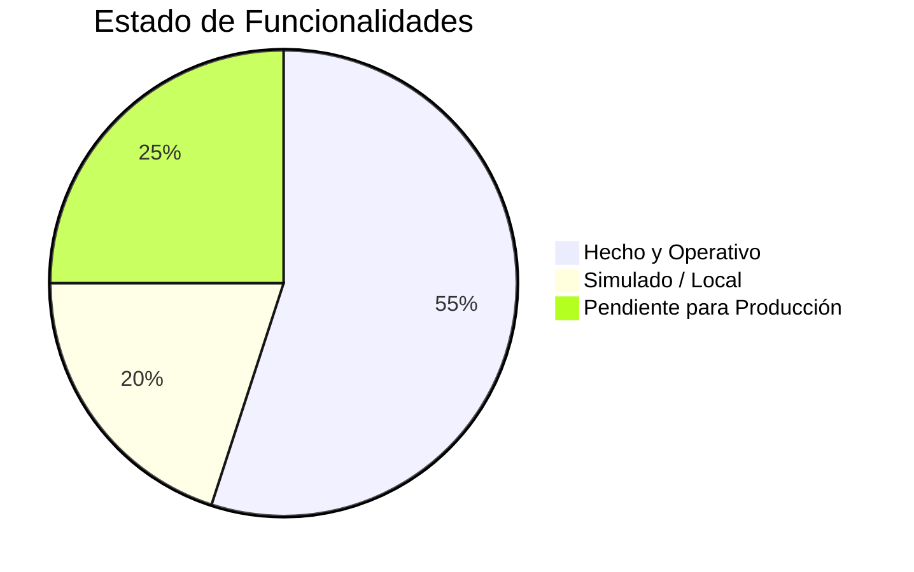

# 🗺️ Hoja de Ruta y Estado del Proyecto: OTRO

> **Lema:** *"¿Necesitás un servicio en tu hogar? Buscá a otro que lo haga por vos"*  
> **Repositorio:** [https://github.com/Facubosack/OTRO](https://github.com/Facubosack/OTRO)  
> **Versión actual:** v0.2.0 (MVP Frontend Funcional & PWA)

---

## 📊 Estado Actual del Proyecto

Este documento detalla qué funcionalidades ya están desarrolladas, qué aspectos funcionan de forma simulada y cuáles son las tareas pendientes para continuar el desarrollo.



---

## ✅ 1. Lo que ya está hecho y funcionando

### 🎨 Interfaz & Experiencia de Usuario (UI/UX)
- [x] **Diseño cálido, blanco y casero:** Interfaz luminosa en blanco puro (`#FFFFFF`) y slate suave (`#F8FAFC`) con acento naranja artesanal (`#EA580C`). Sin aspecto artificial ni neones futuristas.
- [x] **Identidad visual:** Logo vectorial amigable en SVG ([`assets/logo.svg`](./assets/logo.svg)) que representa un hogar y apretón de manos.
- [x] **Hero section barrial:** Pilares de confianza (Trato directo, Gente de tu zona y Presupuestos claros).
- [x] **Buscador interactivo:** Filtro en tiempo real por palabra clave, tarea o barrio (con botón para limpiar búsqueda).
- [x] **Carrusel de rubros:** 10 categorías del hogar con iconos, contadores dinámicos de pedidos abiertos y filtro interactivo.
- [x] **Navegación por pestañas:**
  - *Pedidos del Barrio* (feed en vivo de solicitudes de vecinos).
  - *Especialistas ("Otros")* (directorio de prestadores verificados).
  - *Mis Pedidos* (gestión de solicitudes del usuario activo).
- [x] **Diseño 100% responsivo:** Optimizado tanto para escritorio como para celulares (con barra de navegación inferior fija estilo app nativa).

### ⚙️ Lógica de la Plataforma
- [x] **Publicación de pedidos:** Formulario completo para solicitar ayuda (título, rubro, fecha/urgencia, descripción, barrio y presupuesto estimado).
- [x] **Directorio de prestadores:** Tarjetas con oficios, rating en estrellas, cantidad de trabajos, tarifa orientativa, habilidades y reseñas de vecinos.
- [x] **Sistema de presupuestos y postulaciones:**
  - Los prestadores pueden postularse enviando monto ofertado ($) y mensaje explicativo.
  - El solicitante puede ver las ofertas recibidas y aceptar un presupuesto con un clic.
- [x] **Integración con WhatsApp:** Botón que abre directamente WhatsApp (`wa.me`) con el número del prestador y el texto prearmado con los datos de la tarea.
- [x] **Modo Dual (Switch de Rol):** Alternador inmediato entre *Modo Cliente* ("Necesito ayuda") y *Modo Prestador* ("Soy un Otro").

### 📱 PWA & Código
- [x] **Progressive Web App (PWA):** `manifest.json`, iconos y Service Worker ([`sw.js`](./sw.js)) con soporte offline y aviso de instalación en pantalla de inicio.
- [x] **Estructura modular en JavaScript:** Separado en `data.js`, `storage.js`, `chat.js`, `pwa.js` y `app.js`.
- [x] **Repositorio Git sincronizado:** Rama `main` en GitHub.

---

## ⚠️ 2. Lo que hoy está simulado / funciona a nivel local

- [x] **Persistencia en `localStorage`:** Los pedidos y cambios se guardan en la memoria local del navegador. Si otra persona abre la app desde otro dispositivo, no ve los pedidos creados por vos aún.
- [x] **Chat interno de prueba:** El modal de mensajería responde automáticamente con respuestas contextuales simuladas (aunque el botón de WhatsApp sí redirige a la app real).
- [x] **Perfil fijo:** El usuario activo está definido por defecto como *"Facundo M."* (sin pantalla de inicio de sesión).

---

## 📋 3. Backlog: Próximos pasos a seguir

A continuación se detallan las etapas pendientes para convertir el prototipo en una plataforma real en la calle:

### 🚀 Fase 1: Publicación en Internet (Deploy Público)
- [x] Subir la app a un hosting gratuito con SSL:
  - Repositorio conectado con **Vercel** ([https://github.com/Facubosack/OTRO](https://github.com/Facubosack/OTRO)).
  - URL pública con HTTPS y despliegue automático por cada push a `main`.

### ☁️ Fase 2: Base de Datos en la Nube (Multi-usuario real)
- [x] Conexión en tiempo real con **Firebase Firestore**:
  - Configurado proyecto Firebase (`otro-fbf44`).
  - Colección `tasks` sincronizada en vivo entre todos los dispositivos con listeners `onSnapshot`.
  - Sistema de presupuestos y postulaciones en tiempo real (`bids`).
  - Persistencia offline en IndexedDB integrada con PWA y fallback a `localStorage`.
  - Indicador visual `🟢 EN VIVO` en la cabecera.

### 🔐 Fase 3: Registro y Autenticación de Usuarios
- [x] Autenticación y gestión de usuarios multi-perfil:
  - Login directo con Google (1 clic) vía Firebase Authentication (`signInWithPopup`).
  - Sincronización automática de perfil con colección `users/{uid}` en Firestore.
  - Modal "Mi Perfil": edición de nombre, WhatsApp/teléfono, barrio/localidad y rol (Cliente vs Prestador).
  - Prestadores ("Soy un Otro"): selección de oficios con checkboxes, tarifas orientativas y presentación/bio.
  - Navegación abierta sin barreras para explorar, con prompt de inicio de sesión al publicar pedidos o enviar presupuestos.
  - "Mis Pedidos" vinculado al usuario autenticado en tiempo real.

### 🔔 Fase 4: Notificaciones y Geolocalización
- [x] **Geolocalización Automática & Distancias (`js/geo.js`):**
  - Autocompletado inteligente de barrios, ciudades y provincias argentinas en vivo (Photon/OpenStreetMap sin costos de API key de Google) al escribir en el formulario de publicación y en Mi Perfil.
  - Botón *"📍 Mi ubicación"* con reverse geocoding automático (OpenStreetMap + BigDataCloud) en formularios de publicación y perfil.
  - Cálculo de distancia en km (fórmula de Haversine) y badge en tarjetas de tareas (`📍 a 1.2 km`).
  - Botón de ordenamiento por cercanía (`📍 Más cercanos` / `⏱️ Más recientes`) en el muro de pedidos.
- [x] **Centro de Notificaciones en Tiempo Real & Web Push (`js/notifications.js`):**
  - Campanita de notificaciones en la cabecera con contador de no leídas en vivo.
  - Panel flotante con historial de notificaciones y botón "Marcar leídas".
  - Alertas automáticas para clientes al recibir presupuestos y para prestadores al publicarse tareas de su oficio o aceptarse presupuestos.
  - Soporte de notificaciones del sistema (Web Notification API).

### 💳 Fase 5: Expansión y Mejoras Opcionales
- [ ] Galería de fotos reales de antes/después en los perfiles de los prestadores.
- [ ] Sistema de reseñas y calificaciones reales después de marcar una tarea como completada.
- [ ] Integración opcional de pagos/señas con Mercado Pago.

---

## 🛠️ ¿Cómo retomar el proyecto en la próxima sesión?

1. **Abrir la carpeta del proyecto en la terminal:**
   ```bash
   cd c:\Users\facun\OneDrive\Desktop\APLICACIONES\OTRO\OTRO
   ```

2. **Iniciar el servidor local para probar cambios:**
   ```bash
   python -m http.server 3000
   # O si usás Node:
   npx serve . -l 3000
   ```

3. **Abrir en el navegador:**
   [http://localhost:3000](http://localhost:3000)

4. **Sincronizar cambios en GitHub:**
   ```bash
   git add .
   git commit -m "feat: descripción de los cambios"
   git push origin main
   ```
